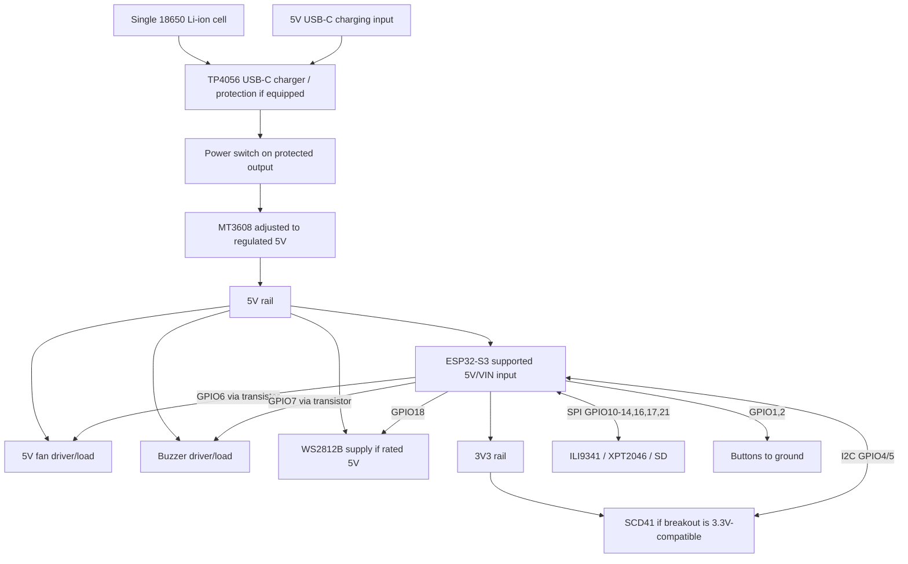

# AirWatch Hardware Schematic and Wiring Guide

## Current source audit correction

This file is an unverified proposal transcription, not a firmware-confirmed pin map or an electrical certification. The PDF exists locally, but its page 10 drawing and pages 11–14 tables were not independently readable with the available tools. The expected firmware sketch is zero bytes in the committed repository and deleted in this worktree. Consequently the tables below must be treated as proposal-only; do not wire or power hardware from them without checking the actual board and module documentation. The alternative TFT pin map described below is also unverified.

> **Status:** Documentation transcription and engineering review; **NOT an electrically validated wiring diagram.** Based on the uploaded 15-page AirWatch proposal, especially visual schematic page 10, components page 11, power chain page 13 and GPIO connections pages 13–14. Verify each module's markings and physical connections with a multimeter **before applying power**.

## Architecture

**Follow-up:** the user-supplied sketch is now present at the expected path and uses the GPIO values listed here. This confirms source constants only; it does not confirm physical wiring or circuit safety.



All supplies/logic share a common GND. This diagram is **functional topology**, not a pin-by-pin certified circuit. Verify power/logic limits of the actual TFT, touch, SD and SCD41 breakout boards; *TFT VCC labeling does not necessarily imply 5V tolerance*.

## Proposal pin assignment

| ESP32-S3 pin | Peripheral / connection | Notes |
|---|---|---|
| GPIO1 | Button 1 to GND | INPUT_PULLUP |
| GPIO2 | Button 2 to GND | INPUT_PULLUP; mute / secondary action |
| GPIO4 | SCD41 SDA | I²C; breakout-compatible pull-ups to 3.3V |
| GPIO5 | SCD41 SCL | I²C; breakout-compatible pull-ups to 3.3V |
| GPIO6 | Fan driver transistor base through resistor | **Not directly to fan** |
| GPIO7 | Buzzer driver transistor base through resistor | **Not directly to buzzer** |
| GPIO10 | TFT CS | Display chip select |
| GPIO11 | TFT SDI / touch T_DIN / SD_MOSI | Shared SPI MOSI |
| GPIO12 | TFT SCK / touch T_CLK / SD_SCK | Shared SPI clock |
| GPIO13 | TFT SDO / touch T_DO / SD_MISO | Shared SPI MISO |
| GPIO14 | TFT D/C | Display data/command |
| GPIO16 | Touch T_CS | Touch chip select |
| GPIO17 | SD_CS | SD card chip select; usage must be verified in software |
| GPIO18 | WS2812B DIN via series resistor | Verify 3.3V logic compatibility with LED supply; level shifter may be needed |
| GPIO21 | TFT RESET | Display reset |
| T_IRQ | Not connected | Firmware polls touch, per proposal |

**Important firmware matching:** The supplied `firmware/AirWatch.ino` uses the proposal pinout above. An older prototype pinout mentioned in previous development (MOSI 41, SCLK 42, CS 47, DC 21, RESET 14) is **different**. Do not connect by mixing these tables. Inspect actual installed wiring and select only one pin profile.

## Li-ion power supply chain — verify before use

```text
USB-C 5 V -> TP4056 IN+ / IN- (or USB-C socket)
18650 cell + / - -> TP4056 B+ / B-
TP4056 protected OUT+ -> ON/OFF switch -> MT3608 IN+
TP4056 protected OUT- ------------------> MT3608 IN-
MT3608 OUT+ (set to 5.0V unloaded, verify under load) -> 5V rail
MT3608 OUT- ------------------------------------------> GND rail
5V rail -> board-approved ESP32 5V/VIN + confirmed 5V loads
ESP32 3V3 -> only verified 3.3V-rated module inputs
```

**Safety-critical checks**

1. The TP4056 must have functioning **cell protection** (overdischarge/overcurrent/short protection) or the cell must be separately protected. TP4056 charging IC alone is not a protection circuit. Check markings and exact module design.
2. Choose charge current appropriate for the particular 18650 cell. Confirm the boost converter's continuous current and input peak current budget covers ESP32 Wi-Fi bursts, TFT, fan, buzzer, and LEDs. A 1200 mAh cell is **not interchangeable** with a 2600 mAh cell in runtime predictions.
3. TP4056-based units generally do not provide true power-path/load sharing; simultaneous charging and active operation can affect charge termination and safety. Test and/or use an appropriate power-path solution.
4. Check whether the exact ESP32 board has a 5V/VIN pin intended for regulated 5V; never apply 5V to ESP32 3V3 or GPIO. Never supply the board with both external 5V and USB without validating backfeed protection.
5. Add an appropriately rated fuse / protective device where practical; secure insulation and strain relief. Do not leave a bare 18650/perfboard assembly exposed.
6. Fan wiring: 5V+ -> fan+; fan- -> low-side transistor collector/drain; emitter/source -> GND; GPIO6 -> properly sized base/gate resistor. Place a flyback diode **across fan** with cathode to fan+ and anode to the switched negative side. Verify transistor current and logic drive.
7. Buzzer: use a driver if its current exceeds safe GPIO limits; confirm whether it is active/passive and whether a flyback diode is appropriate for that specific part.
8. Check voltage levels and logic shifting for 5V-powered WS2812B and any 5V TFT breakout. Don't rely on labels alone.
9. Test converter output with a meter BEFORE ESP32 connection, then again under expected load; assess temperature and brownout resets.

## Modules and design notes

| Part | Proposal quantity | Notes |
|---|---:|---|
| ESP32-S3-WROOM-1 DevKitC-1 | 1 | Verify actual N16R8 module and exposed pins |
| SCD41 | 1 | I²C CO₂, temperature and RH |
| 2.8-inch ILI9341 + XPT2046 + SD | 1 | Confirm power tolerance and SPI bus sharing |
| WS2812B | 1 strip | Schematic component list depicts 6 LEDs; public sketch initializes 1 LED: reconcile count |
| 5V cooling fan | 1 | Switched driver + flyback diode |
| Active buzzer | 1 | Driver output |
| Push buttons | 2 | Active-low to ground |
| 2N3904 NPN transistors | 2 | Verify fan current is within transistor rating and saturation capability |
| 1N4007-style diodes | 2 | Confirm placement / load purpose |
| Resistors | several | Exact values must be derived from device specifications |
| Single 18650 battery and holder | 1 | Capacity varies across document/prototype revisions |
| TP4056 USB-C module | 1 | Verify protection on the exact module |
| MT3608 boost converter | 1 | Verify stable 5V output and peak load |
| Rocker switch | 1 | Wire true switch terminals, not blindly use printed GND/POWER/ACC labels |

## Functional alarm thresholds in existing GitHub sketch

- Auto fan ON at **30°C**, OFF at **28°C**, providing temperature hysteresis.
- CO₂ audible alarm ON at **2000 ppm**, OFF at **1800 ppm**, providing alarm hysteresis.
- Proposal page 3 still contains an unfilled threshold placeholder; **these are implementation defaults, not exposure or occupational health standards**. Confirm with the team/adviser.

## Bring-up checklist (do not skip)

- [ ] Compare the physical board pin labels against this table and current `.ino` constants.
- [ ] Inspect solder joints, short circuits and switch wiring with power disconnected.
- [ ] Confirm TP4056 includes battery protection, correct polarity and supported charge current.
- [ ] Verify 5.0V boost output without peripherals; verify regulated output under load.
- [ ] Power ESP32 alone and check 3V3 and serial logs.
- [ ] Attach/test SCD41 via I²C first.
- [ ] Attach/test ILI9341 display; then touch; then SD if used.
- [ ] Test WS2812B with appropriate logic-level/power provisions.
- [ ] Test fan and buzzer driver stages individually, monitoring current and transistor heating.
- [ ] Test simultaneous Wi-Fi and peripheral operation for brownouts.
- [ ] Test operation with charger disconnected, charging behavior, and safe shutdown.
- [ ] Record photos, meter readings and physical pass/fail results.

## Source of truth and remaining uncertainties

- Document: `Docs/AirWatch_ Wireless Air Tracking & CO₂ Handling — An IoT-Based Indoor Air Quality and Safety Monitoring Device.pdf`, pages 10–14 (uploaded proposal available in the conversation; repo Docs presence not independently confirmed).
- Source code: `firmware/AirWatch.ino` in the current workspace.
- Open verification items: TP4056 actual module/overdischarge protection; ESP32 board 5V input path; exact TFT breakout supply rating; exact fan current, transistor/resistor values; NeoPixel count and voltage shifting; actual physical GPIO wiring; SD functionality; battery capacity.
