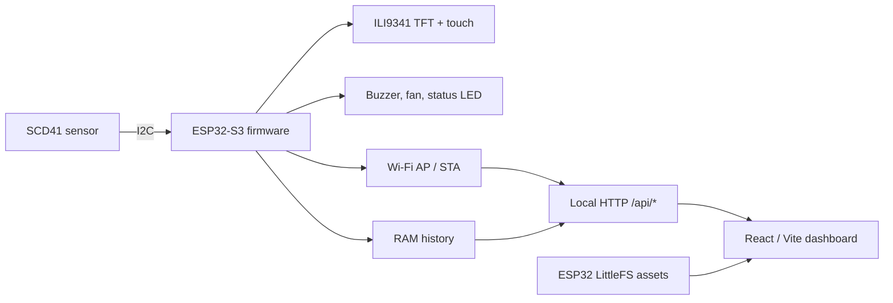

# AirWatch — IoT Indoor Air Quality Monitoring Platform

## Current workspace audit (2026-11-16)

The dashboard and the user-supplied ESP32 sketch are now present. The sketch includes local Wi-Fi, API and LittleFS changes; its Arduino compile and all physical tests remain unverified. The proposal PDF exists locally, but its schematic and component/pin tables could not be independently inspected here, so the source GPIO map still needs physical confirmation. See the firmware/API/test docs linked below.

**Update:** the sketch supplied by the user has since been written to the expected path and extended with the local API and dashboard server. The earlier audit paragraph above is retained as baseline history; see the current implementation notes below and [`firmware/README.md`](firmware/README.md). The Arduino build and physical wiring remain unverified.

## Local and Render hosting

- **Local device mode:** the ESP32 starts a protected setup AP and serves the built dashboard from LittleFS. Connect to the AP and open `http://192.168.4.1`. Router STA access is supported after credentials are configured.
- **Local development mode:** set `AIRWATCH_DEVICE_URL=http://192.168.4.1` and run `npm run dev`; Vite proxies `/api/*` from a computer on the same LAN.
- **Render:** `render.yaml` deploys the React/Vite frontend as a Static Site (`npm ci`, `npm run build`, publish `dist`). The public site hosts the UI over HTTPS but does not relay telemetry or commands. Keep device API access local; do not port-forward the ESP32. Remote access needs a separately implemented authenticated HTTPS/MQTT gateway.

Render static-site setup follows its [Static Sites documentation](https://render.com/docs/static-sites). The dashboard is a single-page app served from `/`.

**ESP32-S3 indoor CO₂, temperature and humidity monitor with a local React dashboard, display, and alarms.**

> **Project status:** Prototype / hardware verification required. The public repository contains an ESP32-S3 Arduino sketch and React/Vite dashboard. A previous repository README reports software compilation but no physical flash or hardware test. This document does **not** claim that physical testing or true cloud telemetry has been completed.

## Overview

AirWatch is an IoT-based prototype developed for the University of Southeastern Philippines ICE 311 Professional Elective 1 project, *Wireless Air Tracking & CO₂ Handling — An IoT-Based Indoor Air Quality and Safety Monitoring Device*. It aims to make indoor ventilation conditions more observable in classrooms, offices and study rooms using an SCD41 sensor. The device displays current sensor readings locally, produces alerts at configured thresholds, and makes history and controls available on a Wi-Fi dashboard.

**AirWatch reports CO₂, temperature and relative humidity only.** It does not directly measure PM2.5, VOCs, carbon monoxide, smoke, or all indoor air pollutants. CO₂ thresholds are ventilation indicators and should not be presented as universal medical safety limits.

## Features and status

| Capability | Repository implementation / intended behavior | Verification |
|---|---|---|
| CO₂, temperature, relative humidity | SCD41 over I²C | Hardware test required |
| Landscape TFT | ILI9341 320×240 via SPI, XPT2046 touch | Hardware test required |
| CO₂ audible warning | Active buzzer through switched driver | Hardware test required |
| Temperature-responsive fan | Auto/on/off; 30°C on / 28°C off defaults | Hardware test required |
| CO₂ alarm hysteresis | 2000 ppm on / 1800 ppm off defaults | Hardware test required |
| Visual indicator | WS2812B NeoPixel | Verify physical LED count |
| Wi-Fi access | ESP32 SoftAP + optional STA | Network/hardware test required |
| Local dashboard | React/Vite, hosted by ESP32 LittleFS or dev server | Build and physical test required |
| Web controls | X-AirWatch-Key authenticated fan, mute, Wi-Fi | Contract/integration testing required |
| History | Bounded RAM samples (not durable across resets) | Verify device behavior |
| Cloud / internet remote monitoring | Project proposal objective, **not established by the repository local HTTP implementation** | Not yet verified/implemented |
| Rechargeable battery | Proposed 18650 + TP4056 + MT3608 | Electrical-safety verification required |

## System architecture



The ESP32 can serve a compiled frontend from LittleFS at `http://192.168.4.1/` when accessed through its SoftAP (default AP gateway); STA addresses depend on your router. Browser dev mode uses the Vite proxy. **No Internet connection is required for local monitoring on the device AP.**

## Repository layout

`	ext
AirWatchIoTMonitoringPlatform/
|-- src/
|-- public/
|-- firmware/
|   |-- AirWatch.ino
|   |-- README.md
|   |-- libraries.txt
|-- Docs/
|-- package.json
|-- render.yaml
|-- README.md
`

## Hardware (proposal)

- ESP32-S3-WROOM-1 DevKitC-1 (verify actual N16R8 variant)
- Sensirion SCD41 CO₂ / temperature / RH sensor
- ILI9341 2.8-inch 320×240 TFT, XPT2046 touch, optional microSD slot
- WS2812B addressable status LED(s), 5V fan, active buzzer, two buttons
- Driver transistors/resistors, flyback diode for fan, shared ground
- 18650 Li-ion battery, verified protected charging circuit, boost converter and switch

For the pin list and **mandatory electrical precautions**, see [`Docs/SCHEMATIC.md`](Docs/SCHEMATIC.md). The proposal page 10 is a visual layout and **must not be treated as an electrically certified circuit**.

### GPIO reference

| Peripheral | GPIO |
|---|---|
| SCD41 SDA / SCL | 4 / 5 |
| Fan driver / buzzer driver | 6 / 7 |
| Buttons | 1 / 2 |
| TFT CS / MOSI / SCK / MISO | 10 / 11 / 12 / 13 |
| TFT DC / RESET | 14 / 21 |
| Touch CS / SD CS | 16 / 17 |
| WS2812B DIN | 18 |

Pin values are from the uploaded proposal and supplied `firmware/AirWatch.ino`. **Older prototypes may have different TFT GPIOs; verify actual physical wiring.**

## Run the dashboard in VS Code

Prerequisites: Node.js (a version supported by your project's dependency set), pnpm, a computer with network access to the ESP32, and a cloned checkout of this repository.

```bash
git clone https://github.com/Devon35K/AirWatchIoTMonitoringPlatform.git
cd AirWatchIoTMonitoringPlatform
pnpm install
```

In PowerShell, set the Vite proxy target for this terminal session:

```powershell
$env:AIRWATCH_DEVICE_URL = 'http://192.168.4.1'
pnpm dev
```

On macOS/Linux:

```bash
AIRWATCH_DEVICE_URL=http://192.168.4.1 pnpm dev
```

Open the local URL printed by Vite. Your computer must be connected to the AirWatch Wi-Fi AP or the same reachable LAN. `/api/*` is proxied by Vite to the device; avoid browser CORS problems by using that proxy.

When the device is unavailable, the UI should show an offline state rather than fabricated readings.

## Build and deploy the dashboard to LittleFS

```bash
pnpm build
```

The Vite build emits `dist/`. The public repository's firmware serves files from ESP32 LittleFS. Upload the **contents** of `dist/` into the matching ESP32 LittleFS data partition using a filesystem upload method compatible with your installed ESP32 Arduino core. Select an appropriate partition scheme with sufficient space for the firmware and at least ~1 MB of LittleFS allocation; inspect actual binary sizes and boot logs before finalizing.

The existing firmware README states roughly 340 KB uncompressed production assets at the time of its report; **re-check actual new build size** after updates. A 16MB N16R8 chip does not mean all 16MB is allocated to LittleFS.

If you see `AirWatch dashboard files are missing from LittleFS`, check mount success, partition layout, and `index.html` at the filesystem root.

## Arduino / ESP32-S3 firmware

Open `firmware/AirWatch.ino` using Arduino IDE or a VS Code Arduino workflow. Configure the actual ESP32-S3 board profile, correct flash size, PSRAM and compatible partition scheme. Verify these values for the actual DevKit module rather than copying arbitrary settings.

The sketch uses:

- Arduino ESP32 core (WiFi, WebServer, Preferences, LittleFS, Wire, SPI)
- Adafruit GFX and Adafruit ILI9341
- XPT2046 Touchscreen
- Adafruit NeoPixel
- Sensirion I2C SCD4x library
- QR encoding supported by the selected ESP32 core

**Pin and library compatibility may vary with installed core versions.** Install version-compatible dependencies, compile the sketch and keep a record of exact versions in `firmware/README.md`. Flash over the correct serial port, then open Serial Monitor at **115200 baud**.

Expected first-test sequence: inspect 5V/3.3V rails; boot ESP32 alone; test SCD41 I²C; test TFT; test touch; test driver outputs; verify AP connection; test APIs; upload LittleFS assets and verify dashboard. Never connect a 5V fan directly to ESP32 GPIO.

## HTTP API contract

The public repository documents these routes:

| Method | Route | Purpose |
|---|---|---|
| GET | `/api/status` | Current device readings and state |
| GET | `/api/history` | Historical sample data |
| POST | `/api/control` | Fan mode, alarm mute, and TFT theme controls |
| POST | `/api/wifi` | Station Wi-Fi configuration |

Mutating routes require `X-AirWatch-Key` obtained through the device's authorized setup workflow. Example (PowerShell):

```powershell
$device = 'http://192.168.4.1'
$key = '<ENTER-YOUR-DEVICE-CONTROL-KEY>'
Invoke-RestMethod "$device/api/status"
Invoke-RestMethod "$device/api/history"
Invoke-RestMethod -Method Post "$device/api/control" -Headers @{ 'X-AirWatch-Key' = $key } -ContentType 'application/json' -Body '{"fanMode":"auto"}'
Invoke-RestMethod -Method Post "$device/api/control" -Headers @{ 'X-AirWatch-Key' = $key } -ContentType 'application/json' -Body '{"muted":true}'
Invoke-RestMethod -Method Post "$device/api/control" -Headers @{ 'X-AirWatch-Key' = $key } -ContentType 'application/json' -Body '{"displayTheme":"dark"}'
```

Wi-Fi setup payload shape: `{"ssid":"YOUR_SSID","password":"YOUR_PASSWORD"}` to `/api/wifi` with the same header. Never commit a live access key or router password. Check current firmware handler for exact response JSON before implementing a new client or writing test fixtures.

The device's history includes Unix epoch seconds when a valid clock is available, otherwise uptime-derived timestamps. Restarting the device clears its volatile sample history.

## Security and safety

**Local prototype only.** The ESP32 HTTP server does not provide transport encryption. Anyone able to inspect the local HTTP path may observe headers including its control key. Do **not** expose device HTTP directly to the public Internet. For secure remote/cloud monitoring, use a separately authenticated HTTPS gateway/backend and treat it as a future integration until implemented.

**Battery warning.** The design must use a correctly protected cell/charging arrangement with verified polarity/current ratings. Do not assume every TP4056 board has battery protection or safe load sharing. The MT3608 must be correctly adjusted to 5.0V and checked with a multimeter *before connecting electronics*. Never apply 5V to 3V3 or GPIO. Verify the exact ESP32 5V/VIN input design, breakout voltage ratings, and protection against USB/external power backfeed. See the full checklist in `Docs/SCHEMATIC.md`.

## Testing and evaluation

The project proposal evaluates (1) functionality, (2) sensor accuracy, (3) transmission reliability, (4) warning response time, (5) usability, and (6) electrical/operational safety. Document observed values, test date and evidence before making claims of meeting these objectives. Cross-check sensor readings with a known reference device under controlled conditions; repeat tests with Wi-Fi up/down and on battery power.

## Troubleshooting

| Symptom | First checks |
|---|---|
| Blank/white TFT | TFT VCC/ground, correct SPI pin profile, correct CS/DC/RST, module voltage tolerance |
| SCD41 not detected | SDA GPIO4, SCL GPIO5, stable 3.3V-compatible supply, I²C address and pull-ups |
| Device reboots on Wi-Fi or fan start | Battery and boost converter current capability, low voltage, ground, inrush and brownout logs |
| AP works but website is missing | LittleFS mount, correct partition, `dist/` files uploaded to root |
| 401 / unauthorized control | Correct `X-AirWatch-Key`, no query-string secrets |
| Chart shows no timestamps | Check device clock/NTP and uptime fallback |
| Dashboard displays offline | Device reachable, correct Vite proxy target, same network |
| Fan never starts | GPIO6 transistor driver, correctly rated transistor, flyback diode, mode/temperature |

## Limitations and roadmap

The project currently concentrates on indoor CO₂, temperature and RH; it is **not** a complete air pollution analyzer or certified safety monitor. Run time depends on battery condition and load. Remote monitoring requires a reachable network and a separate secure gateway if accessed outside the local LAN.

Next steps: confirm hardware revision and wiring; finish end-to-end firmware/frontend tests; document the actual API response schemas; ensure battery safety; optionally add deliberate long-term logging, robust alert history, and authenticated cloud telemetry.

## Project source and acknowledgment

Proposal: *AirWatch: Wireless Air Tracking & CO₂ Handling — An IoT-Based Indoor Air Quality and Safety Monitoring Device*, ICE 311, University of Southeastern Philippines, submitted September 22, 2026. Hardware schematic and component/pin lists appear on pages 10–14.

Repository: https://github.com/Devon35K/AirWatchIoTMonitoringPlatform

**Maintainers:** Refer to project contributors in the original proposal and Git commit history; do not infer implementation authorship from this README revision.
