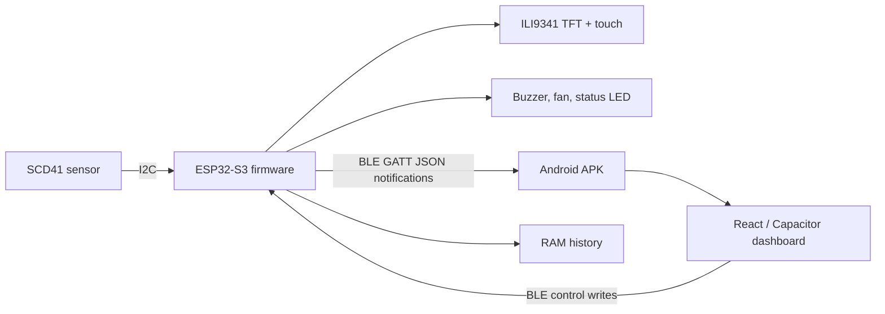

# AirWatch — IoT Indoor Air Quality Monitoring Platform

## Current workspace status (2026-11-22)

The firmware now uses BLE only for phone communication. Its Arduino compile, connection to the APK, and all physical tests remain unverified. Verify the source GPIO map against actual hardware before power-up. See the firmware/protocol/test docs linked below.

See [`firmware/README.md`](firmware/README.md) for the BLE UUIDs and build instructions. The Android app scans/connects and receives status notifications; Wi-Fi, HTTP, and LittleFS are not used by the device.

## App and hosting

- **Android APK:** connects directly to the ESP32 over BLE; the phone and device do not need a router or internet connection.
- **Web / Render:** `render.yaml` deploys the React/Vite interface as a Static Site (`npm ci`, `npm run build`, publish `dist`).
- **Private cloud sync:** when configured with Supabase, the signed-in APK forwards valid BLE readings over the phone's internet connection. The signed-in website reads the same account's private history. The ESP32 remains BLE-only.
- **APK download:** the website's login page and sidebar include a download button for `public/downloads/airwatch.apk`.

Render static-site setup follows its [Static Sites documentation](https://render.com/docs/static-sites). The dashboard is a single-page app served from `/`.

### Configure private Supabase sync

1. Create a Supabase project and run [`supabase/schema.sql`](supabase/schema.sql) in its SQL Editor. The table uses row-level security so authenticated users can only read and insert their own rows.
2. Copy `.env.example` to `.env` for local APK builds and set `VITE_SUPABASE_URL` plus the project's **anon/public key**. Do not put a service-role key in the website or APK.
3. Add the same two variables to the Render Static Site's Environment settings and redeploy. Configure the Supabase Auth Site URL and allowed redirect URLs for the Render domain.
4. Sign in with the same account in the APK and website. While signed in and connected over BLE, the APK uploads valid readings at most once every 30 seconds; the site shows the latest 360 stored readings.
5. To publish an APK download, build the APK and copy it to `public/downloads/airwatch.apk`, then rebuild/redeploy the website:

   ```powershell
   npm run build:apk
   New-Item -ItemType Directory -Force public/downloads
   Copy-Item android/app/build/outputs/apk/debug/app-debug.apk public/downloads/airwatch.apk -Force
   npm run build
   ```

Without Supabase environment variables, the browser dashboard and APK download still work, but private cloud sync is disabled. Supabase's anon key is intended for client apps; row-level security, not a hidden key, protects readings.

## Android APK

The Android app wraps the dashboard with Capacitor and its BLE plugin. Install Android Studio with an Android SDK, enable Bluetooth on the phone, then run `npm run build:apk` on Windows. The debug APK is written to `android/app/build/outputs/apk/debug/app-debug.apk`. Grant Bluetooth permissions and use the app to scan/connect to the advertised `AirWatch-XXXX` device. If Supabase is configured, sign in with the account used on the website to enable private cloud uploads.

**ESP32-S3 indoor CO₂, temperature and humidity monitor with a local React dashboard, display, and alarms.**

> **Project status:** Prototype / hardware verification required. The public repository contains an ESP32-S3 Arduino sketch and React/Vite dashboard. A previous repository README reports software compilation but no physical flash or hardware test. This document does **not** claim that physical testing or true cloud telemetry has been completed.

## Overview

AirWatch is an IoT-based prototype developed for the University of Southeastern Philippines ICE 311 Professional Elective 1 project, *Wireless Air Tracking & CO₂ Handling — An IoT-Based Indoor Air Quality and Safety Monitoring Device*. It aims to make indoor ventilation conditions more observable in classrooms, offices and study rooms using an SCD41 sensor. The device displays current sensor readings locally, produces alerts at configured thresholds, and transfers live readings and controls to the Android APK over BLE.

**AirWatch reports CO₂, temperature and relative humidity only.** It does not directly measure PM2.5, VOCs, carbon monoxide, smoke, or all indoor air pollutants. CO₂ thresholds are ventilation indicators and should not be presented as universal medical safety limits.

## Features and status

| Capability | Repository implementation / intended behavior | Verification |
|---|---|---|
| CO₂, temperature, relative humidity | SCD41 over I²C | Hardware test required |
| Landscape TFT | ILI9341 320×240 via SPI, XPT2046 touch | Hardware test required |
| CO₂ audible warning | Active buzzer through switched driver | Hardware test required |
| Temperature-responsive fan | Auto/on/off; 30°C on / 28°C off defaults | Hardware test required |
| CO₂ alarm hysteresis | 2000 ppm on / 1800 ppm off defaults | Hardware test required |
| Visual indicator | WS2812B NeoPixel | Verify physical LED count |
| Phone connection | BLE advertisement, GATT status notifications and control writes | BLE/hardware test required |
| Dashboard | React/Vite Android APK; browser/Render build is UI-only | APK build and device test required |
| Controls | BLE fan, mute and theme commands | BLE/hardware test required |
| History | APK builds an in-memory chart from received BLE notifications | Device integration test required |
| Cloud / internet remote monitoring | Not implemented; phone must be nearby and connected over BLE | Not implemented |
| Rechargeable battery | Proposed 18650 + TP4056 + MT3608 | Electrical-safety verification required |

## System architecture



The APK communicates directly with the device over BLE. The browser and Render site do not connect to device telemetry; there is no Wi-Fi or HTTP device endpoint in the current firmware.

## Repository layout

`	ext
AirWatchIoTMonitoringPlatform/
|-- src/
|-- public/
|-- firmware/
|   |-- AirWatch.ino
|   |-- README.md
|   |-- libraries.txt
|-- Docs/
|-- package.json
|-- render.yaml
|-- README.md
`

## Hardware (proposal)

- ESP32-S3-WROOM-1 DevKitC-1 (verify actual N16R8 variant)
- Sensirion SCD41 CO₂ / temperature / RH sensor
- ILI9341 2.8-inch 320×240 TFT, XPT2046 touch, optional microSD slot
- WS2812B addressable status LED(s), 5V fan, active buzzer, two buttons
- Driver transistors/resistors, flyback diode for fan, shared ground
- 18650 Li-ion battery, verified protected charging circuit, boost converter and switch

For the pin list and **mandatory electrical precautions**, see [`Docs/SCHEMATIC.md`](Docs/SCHEMATIC.md). The proposal page 10 is a visual layout and **must not be treated as an electrically certified circuit**.

### GPIO reference

| Peripheral | GPIO |
|---|---|
| SCD41 SDA / SCL | 4 / 5 |
| Fan driver / buzzer driver | 6 / 7 |
| Buttons | 1 / 2 |
| TFT CS / MOSI / SCK / MISO | 10 / 11 / 12 / 13 |
| TFT DC / RESET | 14 / 21 |
| Touch CS / SD CS | 16 / 17 |
| WS2812B DIN | 18 |

Pin values are from the uploaded proposal and supplied `firmware/AirWatch.ino`. **Older prototypes may have different TFT GPIOs; verify actual physical wiring.**

## Run the dashboard UI in VS Code

Prerequisites: Node.js (a version supported by the dependency set), pnpm, and a cloned checkout of this repository. Browser mode is for interface development and does not connect to the BLE device.

```bash
git clone https://github.com/Devon35K/AirWatchIoTMonitoringPlatform.git
cd AirWatchIoTMonitoringPlatform
pnpm install
```

Run `pnpm dev` and open the local URL printed by Vite to work on the interface.

When the device is unavailable, the UI should show an offline state rather than fabricated readings.

## Build the Android APK

```bash
npm run build:apk
```

The build requires the Android SDK and creates `android/app/build/outputs/apk/debug/app-debug.apk`. Install the APK, enable Bluetooth, grant its requested permissions, and connect to the nearby AirWatch device.

## Arduino / ESP32-S3 firmware

Open `firmware/AirWatch.ino` using Arduino IDE or a VS Code Arduino workflow. Configure the actual ESP32-S3 board profile, correct flash size, PSRAM and compatible partition scheme. Verify these values for the actual DevKit module rather than copying arbitrary settings.

The sketch uses:

- Arduino ESP32 core (BLE, Preferences, Wire, SPI)
- Adafruit GFX and Adafruit ILI9341
- XPT2046 Touchscreen
- Adafruit NeoPixel
- Sensirion I2C SCD4x library

**Pin and library compatibility may vary with installed core versions.** Install version-compatible dependencies, compile the sketch and keep a record of exact versions in `firmware/README.md`. Flash over the correct serial port, then open Serial Monitor at **115200 baud**.

Expected first-test sequence: inspect 5V/3.3V rails; boot ESP32 alone; test SCD41 I²C; test TFT; test touch; test driver outputs; verify BLE advertising and APK discovery; confirm status notifications and controls. Never connect a 5V fan directly to ESP32 GPIO.

## BLE protocol

The device advertises the AirWatch BLE service and sends status JSON notifications every two seconds. The APK writes fan, mute, and theme commands to the control characteristic. The status shape and UUIDs are documented in [`Docs/API.md`](Docs/API.md). No HTTP endpoints or Wi-Fi setup are provided by this firmware.

The app's live chart history is assembled from notifications and remains in app memory. Device epoch timestamps are zero because there is no clock/network time source.

## Security and safety

**Local prototype only.** BLE is not paired or authenticated in this prototype. A nearby BLE client can read sensor data and send device controls. Keep the device in a trusted, nearby environment. No remote/cloud monitoring is implemented.

**Battery warning.** The design must use a correctly protected cell/charging arrangement with verified polarity/current ratings. Do not assume every TP4056 board has battery protection or safe load sharing. The MT3608 must be correctly adjusted to 5.0V and checked with a multimeter *before connecting electronics*. Never apply 5V to 3V3 or GPIO. Verify the exact ESP32 5V/VIN input design, breakout voltage ratings, and protection against USB/external power backfeed. See the full checklist in `Docs/SCHEMATIC.md`.

## Testing and evaluation

The project proposal evaluates (1) functionality, (2) sensor accuracy, (3) transmission reliability, (4) warning response time, (5) usability, and (6) electrical/operational safety. Document observed values, test date and evidence before making claims of meeting these objectives. Cross-check sensor readings with a known reference device under controlled conditions; repeat BLE disconnect/reconnect tests and test on battery power.

## Troubleshooting

| Symptom | First checks |
|---|---|
| Blank/white TFT | TFT VCC/ground, correct SPI pin profile, correct CS/DC/RST, module voltage tolerance |
| SCD41 not detected | SDA GPIO4, SCL GPIO5, stable 3.3V-compatible supply, I²C address and pull-ups |
| Device reboots when BLE or fan starts | Battery and boost converter current capability, low voltage, ground, inrush and brownout logs |
| APK cannot find device | Enable Bluetooth, grant Android Bluetooth permissions, keep the ESP32 powered and nearby |
| APK connects but shows no readings | Confirm status notifications are enabled, check BLE MTU negotiation and SCD41 serial output |
| APK control does not apply | Confirm the Android app and firmware use the matching control characteristic UUID |
| Fan never starts | GPIO6 transistor driver, correctly rated transistor, flyback diode, mode/temperature |

## Limitations and roadmap

The project currently concentrates on indoor CO₂, temperature and RH; it is **not** a complete air pollution analyzer or certified safety monitor. Run time depends on battery condition and load. Remote monitoring requires a reachable network and a separate secure gateway if accessed outside the local LAN.

Next steps: confirm hardware revision and wiring; finish end-to-end BLE/APK tests; ensure battery safety; optionally add deliberate long-term logging, robust alert history, and authenticated cloud telemetry.

## Project source and acknowledgment

Proposal: *AirWatch: Wireless Air Tracking & CO₂ Handling — An IoT-Based Indoor Air Quality and Safety Monitoring Device*, ICE 311, University of Southeastern Philippines, submitted September 22, 2026. Hardware schematic and component/pin lists appear on pages 10–14.

Repository: https://github.com/Devon35K/AirWatchIoTMonitoringPlatform

**Maintainers:** Refer to project contributors in the original proposal and Git commit history; do not infer implementation authorship from this README revision.
